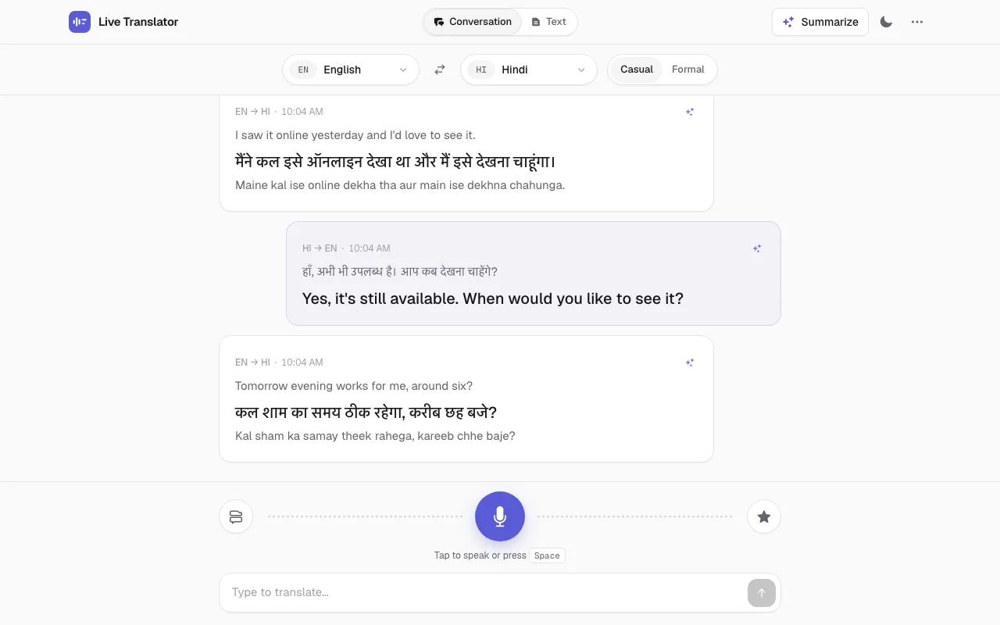
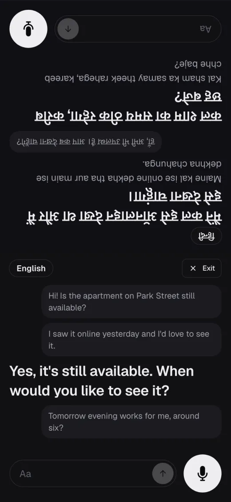

# Live Translator

Speak or type in one language and read it in another, live. It remembers what was said before, so names, pronouns, tone and idioms carry through the whole conversation instead of being translated line by line.

**[Try it → live-translator-app.onrender.com](https://live-translator-app.onrender.com/)**

Free, no account. The first visit can take up to a minute while it wakes up.

  
  

## What you can do

- **Talk or type.** Tap the mic (or press Space) and speak; each sentence appears with its translation as soon as you finish it.
- **Face to face.** Put your phone between two people. The screen splits and the top half turns to the other person, so each of you speaks and reads in your own language.
- **Read it out loud the right way.** Hindi, Chinese, Japanese and other scripts come with an easy-to-read pronunciation line, like "Kya hum meeting shukrawar dopahar ko kar sakte hain?".
- **Find a better way to say it.** Tap any translation for more formal, more casual or shorter versions.
- **Casual or formal.** Pick the tone once and every line follows it.
- **Keep what matters.** Star useful phrases, and come back to past conversations later.
- **Show it to someone.** Open any line full screen in large type, with a flip button for the person opposite you.
- **Wrap up.** Get a short summary with action items in both languages, or download the whole conversation.

Works in 70+ languages, in light or dark, on phones and desktops.

## Privacy

Your audio is never stored, and your conversations stay in your own browser. Nothing is saved to an account or a server. You can turn history off or delete it at any time. To transcribe and translate, your speech and text are sent to speech and translation services (Deepgram and Google).

---

Want to run it yourself or contribute? See [docs/DEVELOPMENT.md](docs/DEVELOPMENT.md).

Built by [Dhairya Shah](https://dhairya-shah.onrender.com/) · [LinkedIn](https://www.linkedin.com/in/dhairyashah03/)
