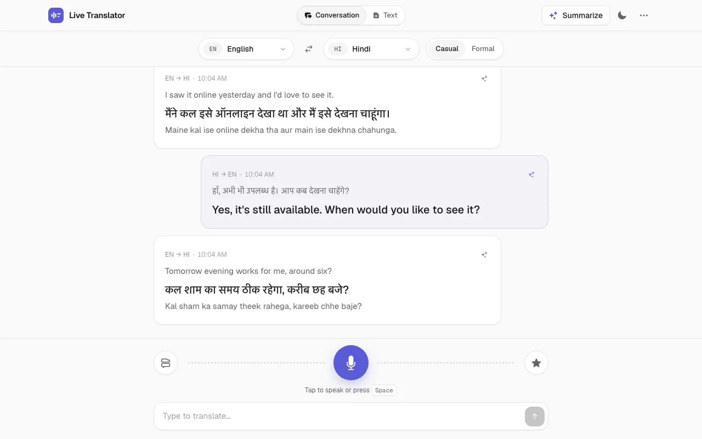
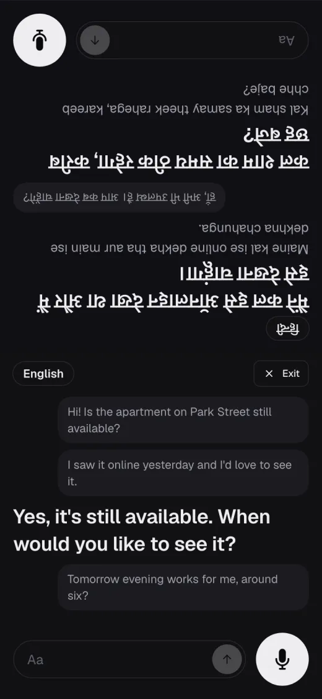

# Live Translator

Speak or type in one language, read a live translation in another. Each finished sentence is translated by Google Gemini with the previous lines as context, so names, pronouns, tone and idioms carry through a conversation, and the app falls back to standard machine translation whenever the AI is slow or unavailable.

**Try it:** [live-translator-app.onrender.com](https://live-translator-app.onrender.com/) (the free backend sleeps when idle, so the first request can take up to a minute)

<p>
  
  
</p>

## Features

- **Conversation.** Tap the mic (or press Space) and talk. Each finished sentence becomes a card with the original and its translation, while a live level meter shows the mic is hearing you. Typing works the same way.
- **Face to face.** Put the phone between two people: the screen splits, the top half turns towards the other person, and each side has its own mic and text box and sees everything in its own language.
- **Text view.** A two-panel translator that translates as you pause typing.
- **Context and tone.** The last few lines go with every request, and a Casual / Formal toggle sets the register.
- **Other ways to say it.** Tap a translation for alternatives (more formal, more casual, shorter, closer to the original) and pick one.
- **Pronunciation.** Non-Latin scripts get a Latin-letter line: everyday Hinglish for Hindi, pinyin for Chinese, Hepburn for Japanese.
- **Saved phrases and history.** Star lines to keep them; past conversations stay in this browser, with an off switch and delete-all.
- **Per line:** listen (using the most natural voice the browser has), copy, share, or show full screen in large type with a flip for the person opposite.
- **Summary and export.** A short summary with action items in both languages, and download as Markdown or plain text.
- **Swap and auto-detect.** Swap languages to let the other person reply; typed text is detected automatically and labelled.
- **Built to keep working.** Lines typed offline wait and translate on reconnect, brief throttling retries quietly, a cold start shows progress, and every failure has Retry.

Light and dark themes, keyboard shortcuts (`?` lists them), 70+ languages, and layouts down to 360px wide.

## How translation works

1. **Speech to text.** The browser records 250 ms audio chunks and streams them over a WebSocket to the backend, which relays them to Deepgram's streaming API. Each final result becomes an utterance.
2. **AI translation.** The utterance goes to Gemini (`@google/genai`) with the last three lines, the tone, and a JSON schema asking for the translation, the detected language and a romanised line.
3. **Model chain.** Models are tried in order: `GEMINI_MODEL`, then `GEMINI_FALLBACK_MODELS` (default `gemini-3.5-flash-lite` → `gemini-3.6-flash` → `gemini-3.8-flash`). Each attempt gets a share of the `GEMINI_TIMEOUT_MS` budget so a hung model leaves time for the next one.
4. **Skip memory and retry.** A model that times out, is overloaded or isn't served on the key is skipped for three minutes. If every model is busy (429/503), the chain pauses `GEMINI_RETRY_PAUSE_MS` and tries once more. After a 400 it retries without the schema and thinking options.
5. **Standard fallback.** If Gemini is missing, throttled, slow or returns something odd, the line goes to Google Translate's public endpoints, then MyMemory, then LibreTranslate (only if configured). Only when all of them fail does the card say "Translation is temporarily unavailable" with Retry.
6. **Never blocking speech.** Transcripts reach the browser as soon as Deepgram finalises them; translations follow when ready.

Gemini usage is capped per IP (translations per minute and per day, summaries per hour) and globally (per minute and per day). When a cap is hit, translation quietly drops to the standard engines; summaries and alternatives say they're busy.

`GET /health` reports whether the Gemini and Deepgram keys are set, the model chain, the last model that answered, and the last Gemini failure, without calling either service.

## Privacy

- Audio is streamed only to transcribe it and is never stored.
- Conversations, history and saved phrases live in the browser's local storage, never on the server or in an account. History can be turned off or deleted from the History sheet.
- Speech and text are sent to Deepgram, Google (Gemini and Translate) and MyMemory to produce results.
- The server logs lengths, timings and engines, never transcript text, and never prints API keys.

## Architecture

```
browser (React)                          backend (Node, Express + ws)                 providers
 ├─ WebSocket  audio, start/stop ───────▶ LiveSession ── audio ───────────────────▶ Deepgram streaming STT
 │             ◀─ transcript, utterance,   └─ translate() ─▶ Gemini model chain ───▶ Google Gemini
 │                translation, notice                     └▶ standard fallback ────▶ Google Translate, MyMemory, LibreTranslate
 └─ REST       /api/translate  /api/alternatives  /api/summarize  /api/status  /health
```

| Endpoint | Purpose |
| --- | --- |
| `WS /` | `start` / `settings` / `stop` messages plus binary audio; replies with `ready`, `transcript`, `utterance`, `translation`, `notice`, `error`, `stopped`. |
| `POST /api/translate` | Typed text: `{ text, sourceLang, targetLang, tone, context }`. |
| `POST /api/alternatives` | Other phrasings: `{ text, translation, sourceLang, targetLang, tone, context }`. |
| `POST /api/summarize` | Summary and action items in both languages: `{ utterances, sourceLang, targetLang }`. |
| `GET /api/status` | What the UI needs: voice available, AI on, text limit. |
| `GET /health` | Configuration and last Gemini outcome, for checking a deploy. |

## Tech stack

- **Frontend:** React 19, TypeScript, Tailwind CSS, Create React App, Web Audio and Web Speech APIs, Geist font
- **Backend:** Node.js 22+, Express, `ws`, `@google/genai`, axios
- **Services:** Deepgram (speech to text), Google Gemini (translation, alternatives, summaries), Google Translate / MyMemory / LibreTranslate (fallback)

## Run it locally

```bash
cd backend
npm install
cp .env.example .env     # add keys if you have them; everything also works without
npm start                # http://localhost:5000
```

```bash
cd frontend
npm install
REACT_APP_WS_URL=ws://localhost:5000 npm start   # http://localhost:3000
```

Without `DEEPGRAM_API_KEY` the mic is disabled and the app is type-only. Without `GEMINI_API_KEY` translation uses the standard engines, and summaries and alternatives are unavailable.

## Configuration

### Backend

| Variable | Default | Purpose |
| --- | --- | --- |
| `DEEPGRAM_API_KEY` | none | Live speech. |
| `DEEPGRAM_MODE` | `standard` | `standard` sends the original Deepgram request. `enhanced` opts into nova-3/nova-2, interim text, sentence grouping and spoken auto-detect (`language=multi`). |
| `GEMINI_API_KEY` | none | Gemini translation, alternatives and summaries ([free key](https://aistudio.google.com/apikey)). |
| `GEMINI_MODEL` | `gemini-3.5-flash-lite` | First model tried. |
| `GEMINI_FALLBACK_MODELS` | `gemini-3.6-flash,gemini-3.8-flash` | Tried in order when a model is overloaded, throttled, slow or unavailable. |
| `GEMINI_THINKING_LEVEL` | `LOW` | `LOW`, `MEDIUM`, `HIGH`, or `OFF` to send no thinking config. |
| `GEMINI_TIMEOUT_MS` | `7000` | Budget per translation across the model chain before falling back. |
| `GEMINI_RETRY_PAUSE_MS` | `600` | Pause before the single retry round when every model is busy. |
| `GEMINI_ALTERNATIVES_TIMEOUT_MS` | `9000` | Budget per alternatives request. |
| `GEMINI_SUMMARY_TIMEOUT_MS` | `20000` | Budget per summary. |
| `TRANSLATION_CONTEXT_TURNS` | `3` | Earlier lines sent as context. |
| `AI_TRANSLATE_PER_MIN` / `AI_TRANSLATE_PER_DAY` | `20` / `300` | Gemini translations and alternatives per client IP. |
| `AI_SUMMARY_PER_HOUR` | `6` | Summaries per client IP. |
| `AI_GLOBAL_PER_MIN` / `AI_DAILY_CAP` | `30` / `1000` | Gemini calls across all users (the daily cap resets at 00:00 UTC). |
| `TRANSLATE_PER_MIN` | `40` | Any translate or alternatives request per client IP. |
| `MAX_SESSION_MINUTES` / `MAX_SOCKETS_PER_IP` | `10` / `3` | Live session length and concurrent sessions per IP. |
| `ALLOWED_ORIGINS` | any | Optional comma-separated allow-list for CORS and WebSocket origins. |
| `LIBRETRANSLATE_URL` / `LIBRETRANSLATE_API_KEY` | none | Optional LibreTranslate instance as the last fallback. |
| `TRUST_PROXY` | `1` on Render | Read the client IP from `X-Forwarded-For` (needed behind Render's proxy). |
| `PORT` | `5000` | Set by Render. |
| `DEEPGRAM_WS_URL` | Deepgram's URL | Test hook; `test:fallback` points it at a fake server. |

### Frontend (build time)

| Variable | Default | Purpose |
| --- | --- | --- |
| `REACT_APP_WS_URL` | `wss://trilogy-r2.onrender.com` | Backend WebSocket. |
| `REACT_APP_API_URL` | derived from `REACT_APP_WS_URL` | Backend HTTP base for `/api/*`. |

## Deploy on Render

**Backend: web service**

- Root directory: `backend`
- Build command: `npm install`
- Start command: `npm start`
- Environment: `DEEPGRAM_API_KEY`, `GEMINI_API_KEY`, plus any variable above. Node 22+ comes from `engines` in `package.json`.
- After deploying, open `/health` to confirm both keys are configured and see which model last answered.

**Frontend: static site**

- Root directory: `frontend`
- Build command: `npm install && npm run build`
- Publish directory: `build`
- Environment: `REACT_APP_WS_URL`, only if the backend isn't `wss://trilogy-r2.onrender.com`.

## Testing

```bash
cd backend
npm run test:fallback   # no API keys needed; uses the internet for the standard engines
npm run smoke:ai        # live Gemini check; needs GEMINI_API_KEY
```

- `test:fallback` stubs the Gemini client and fakes Deepgram, then checks that every Gemini failure (errors, 400/401/404/429/503, hangs, empty or non-JSON output) falls back without delaying the transcript. It also covers the model chain, skip memory, romanisation, alternatives, summaries and `/health`, in both Deepgram modes.
- `smoke:ai` checks context (pronoun agreement), idioms, formal and casual tone, auto-detect and the bilingual summary against the real API.
- `cd frontend && npm test` renders the app as a smoke test.

## Project structure

```
backend/
  server.js               Express routes and the WebSocket server
  lib/config.js           environment variables and defaults
  lib/liveSession.js      one browser socket: Deepgram relay, utterances, translation
  lib/translator.js       Gemini first, standard engines as fallback
  lib/gemini.js           model chain, skip memory, retries, prompts (translate, alternatives, summary)
  lib/legacyTranslate.js  Google Translate, MyMemory, LibreTranslate, with a small cache
  lib/rateLimit.js        per-IP and global limits
  lib/languages.js        language names, Deepgram model mapping, script detection
  lib/log.js              metadata-only logging with key redaction
  scripts/                fallback-test.js, ai-smoke.js
frontend/
  public/                 index.html (meta and share tags), icons, og.png
  src/components/         App and the UI (timeline, face to face, text view, sheets)
  src/hooks/              live session (mic, WebSocket, recorder), theme
  src/lib/                API client, languages, romaniser, voices, local library, export
docs/                     README screenshots
```
